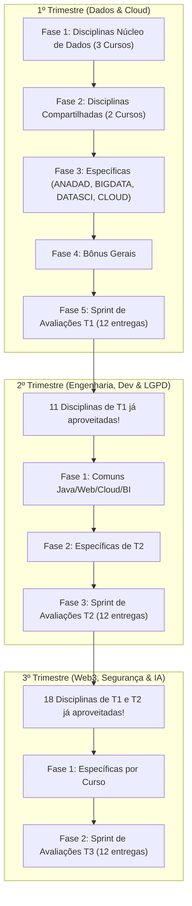

# Planejamento Estratégico de Estudos - Pós-Graduação (2026-2027)

> **Objetivo:** Otimizar o tempo e esforço realizando primeiramente as disciplinas com maior taxa de compartilhamento entre cursos, garantindo a conclusão dos 12 cursos distribuídos em seus respectivos trimestres prioritários, deixando as atividades avaliativas (Avaliação Objetiva, Estudo de Caso e Pitch) para o fechamento de cada trimestre.

---

## 1. Visão Geral e Estratégia de Alavancagem

O catálogo conta com **12 cursos** divididos em **3 trimestres** (4 cursos por trimestre).
A análise identificou um alto índice de reaproveitamento de disciplinas:
- **Disciplinas Chave Multi-Cursos:** Matérias como `Essencial DataBase`, `Python`, `Statistics for Data Science`, `Computação em Nuvem` e `Gestão do Tempo` aparecem em 4 a 5 cursos.
- **Efeito Cascata de Créditos:** As disciplinas cursadas no 1º Trimestre eliminam **11 disciplinas no 2º Trimestre** e **18 disciplinas no 3º Trimestre**.
- **Matérias Complementares Unificadas:** Os módulos de `Tópicos Especiais` (Tecnologia, Diversidade, Carreira e Atualidades) são praticamente universais (aparecem em até 9 cursos). Concluídos no 1º Trimestre, eliminam quase todo o conteúdo complementar dos trimestres seguintes.
- **Ciclo de Avaliações:** Cada curso possui exatamente 3 atividades ao final (Avaliação Objetiva, Estudo de Caso e Pitch). Seguindo a orientação, elas são realizadas em um sprint concentrado ao final de cada trimestre.

---

## 2. Resumo Executivo por Trimestre

| Trimestre | Cursos a Concluir | Disciplinas Já Aproveitadas | Novas Disciplinas Regulares | Matérias Bônus Novas | Total de Avaliações ao Final | Status de Conclusão |
| :--- | :--- | :---: | :---: | :---: | :---: | :--- |
| **1º Tri** | ANADAD, BIGDATA, DATASCI, CLOUD | 0 | 36 | 7 | 12 (3 x 4 cursos) | Conclusão dos 4 primeiros cursos |
| **2º Tri** | ENGSOFT, LGPD, DEVWEB, APPS | **11** | 31 | 1 | 12 (3 x 4 cursos) | Conclusão de mais 4 cursos |
| **3º Tri** | WEB3, SEGINFO, IAMARK, APPEDU | **18** | 32 | 0 | 12 (3 x 4 cursos) | Conclusão dos 4 cursos finais |
| **TOTAL** | **12 Cursos** | **29 créditos poupados** | **99** | **8** | **36** | **100% dos 12 cursos concluídos** |

---

## 3. Cronograma Otimizado

---

## 4. Detalhamento Passo a Passo

### 1º Trimestre
**Cursos Meta:**
- `ANADAD`: Pós-graduação em Análise de Dados (Prioridade 1)
- `BIGDATA`: MBA em Big Data e Inteligência Competitiva (Prioridade 2)
- `DATASCI`: Pós-Graduação em Data Science (Prioridade 3)
- `CLOUD`: Pós-graduação em Projetos de Cloud Computing (Prioridade 4)

#### Fase 1.1: Super-Comuns de Dados (Impacto em 3 cursos simultâneos)
> Ao fazer essas 3 disciplinas, você avança 3 cursos de uma só vez (ANADAD, BIGDATA, DATASCI):
1. **Essencial DataBase** *(Também já adianta ENGSOFT e DEVWEB do 2º Tri!)*
2. **Python** *(Também já adianta WEB3 do 3º Tri!)*
3. **Statistics for Data Science** *(Também já adianta WEB3 do 3º Tri!)*

#### Fase 1.2: Comuns Compartilhadas em Pares (Impacto em 2 cursos)
4. **Data Analytics e Big Data para Tomada de Decisão** (ANADAD + BIGDATA)
5. **Big Data Analytics** (ANADAD + BIGDATA)
6. **Ferramentas para Big Data** (ANADAD + BIGDATA)
7. **Data Integration, Ingestion & Quality** (ANADAD + BIGDATA)
8. **Coleta e Tratamento de Dados** (ANADAD + DATASCI)
9. **Statistics Library in Python** (ANADAD + DATASCI)
10. **Machine Learning** (BIGDATA + DATASCI)
11. **Deep Learning** (BIGDATA + DATASCI)

#### Fase 1.3: Específicas dos Cursos de T1
- **ANADAD (4 matérias):**
  - Estatística Aplicada a Negócios
  - Computação e Inteligência Artificial
  - Privacy and Data Protection *(Adianta APPS e SEGINFO)*
  - Cloud Security *(Adianta SEGINFO)*
- **BIGDATA (3 matérias):**
  - Arquitetura e Modelagem de Dados *(Adianta ENGSOFT)*
  - Linguagem R
  - Visualização de Dados
- **DATASCI (5 matérias):**
  - Learning Programming
  - Clusterização
  - Regressão e Predição
  - Network Science
  - Perceptron e Adaline
- **CLOUD (13 matérias - Trilha de Cloud & Projetos):**
  - Gestão do Tempo *(Adianta LGPD, APPS, APPEDU)*
  - Projeto de Vida *(Adianta LGPD, APPEDU)*
  - Coaching e Planejamento de Carreira *(Adianta LGPD, APPEDU)*
  - Governança e Qualidade de Dados *(Adianta LGPD, APPEDU)*
  - Narrativas, Roteiro e Storyboard *(Adianta LGPD, APPEDU)*
  - Segurança e Privacidade *(Adianta LGPD, APPEDU)*
  - Redes de Comunicação, Protocolos e Roteamento *(Adianta LGPD, APPEDU)*
  - Computação em Nuvem *(Adianta LGPD, APPS, APPEDU)*
  - Da Iniciação ao Orçamento do Projeto
  - Qualidade, Recursos, Comunicação e Riscos de Projetos
  - Execução, Controle e Encerramento de Projetos Ágeis
  - Plataformas de Software na Nuvem para Internet das Coisas
  - Segurança em Infraestrutura de Redes e Computação Móvel

#### Fase 1.4: Módulo Complementar / Bônus (Feito 1 vez para todo o lote)
- Bem-vindo! / Boas-Vindas!
- Gestão do Tempo (Bônus)
- Tópicos Especiais de Tecnologia
- Tópicos Especiais de Diversidade
- Tópicos Especiais de Carreira
- Atualidades pós-graduação

#### Fase 1.5: Sprint Final de Avaliações do 1º Trimestre
Realizar ao final do trimestre para os 4 cursos:
- **ANADAD:** Avaliação Objetiva | Estudo de Caso | Pitch
- **BIGDATA:** Avaliação Objetiva | Estudo de Caso | Pitch
- **DATASCI:** Avaliação Objetiva | Estudo de Caso | Pitch
- **CLOUD:** Avaliação Objetiva | Estudo de Caso | Pitch
*(Total: 12 atividades avaliativas -> 4 Cursos 100% Concluídos!)*

---

### 2º Trimestre
**Cursos Meta:**
- `ENGSOFT`: Pós-graduação em Engenharia de Software (Prioridade 5)
- `LGPD`: Pós-graduação em Privacidade e Proteção de Dados Pessoais (Prioridade 6)
- `DEVWEB`: Pós-Graduação em Desenvolvimento Full Stack (Prioridade 7)
- `APPS`: Pós-graduação em Projetos de Aplicativos Móveis Multiplataforma (Prioridade 8)

#### Créditos Herdados de T1 (11 Disciplinas Já Concluídas!):
Você **NÃO** precisa cursar:
- `Essencial DataBase` (Aproveitada em ENGSOFT e DEVWEB)
- `Arquitetura e Modelagem de Dados` (Aproveitada em ENGSOFT)
- `Gestão do Tempo` (Aproveitada em LGPD e APPS)
- `Projeto de Vida` (Aproveitada em LGPD)
- `Coaching e Planejamento de Carreira` (Aproveitada em LGPD)
- `Governança e Qualidade de Dados` (Aproveitada em LGPD)
- `Narrativas, Roteiro e Storyboard` (Aproveitada em LGPD)
- `Segurança e Privacidade` (Aproveitada em LGPD)
- `Redes de Comunicação, Protocolos e Roteamento` (Aproveitada em LGPD)
- `Computação em Nuvem` (Aproveitada em LGPD e APPS)
- `Privacy and Data Protection` (Aproveitada em APPS)
- *Todos os Bônus principais já estão aproveitados.*

#### Fase 2.1: Comuns do 2º Trimestre (Fazer Primeiro)
1. **Lógica de Programação com Java** (ENGSOFT + DEVWEB)
2. **Interface de Software** (ENGSOFT + DEVWEB)
3. **Cloud diversity AWS** (ENGSOFT + DEVWEB)
4. **Practitioner Front-End** (DEVWEB + APPS) *(Também adianta WEB3)*
5. **Análise de Dados e BI para Tomada de Decisão** (ENGSOFT + APPS) *(Também adianta IAMARK)*

#### Fase 2.2: Específicas do 2º Trimestre
- **ENGSOFT (6 matérias):**
  - Gerenciamento Avançado de Projetos
  - Metodologias de Desenvolvimento de Software
  - Programação Extrema
  - Estruturas de Dados para Sistemas Inteligentes
  - Arquitetura de BI e Big Data
  - Plataformas para Desenvolvimento em Nuvem
- **LGPD (4 matérias):**
  - O ecossistema da LGPD
  - Análise de conformidade com a LGPD
  - Tratamento e Resposta à Incidentes
  - Sistema de Gestão de Proteção e Privacidade de Dados
  - Mapeamento de Fluxo de Dados
- **DEVWEB (7 matérias):**
  - Intermediary Front-End *(Adianta WEB3)*
  - Advanced Front-end *(Adianta WEB3)*
  - Strategies BackEnd
  - Refactoring
  - Intermediary BackEnd
  - Advanced BackEnd
  - Hero Cloud developer
- **APPS (8 matérias):**
  - Gestão Ágil de Projetos
  - Fundamentos da Gestão de Projetos
  - Governança de Dados
  - Cybersecurity Essentials *(Adianta SEGINFO)*
  - Networking Essentials *(Adianta SEGINFO)*
  - Mercado de Aplicações Móveis
  - Desenvolvimento em plataformas hibridas: Flutter
  - Desenvolvimento em plataformas híbridas: React Native

#### Fase 2.3: Bônus Único Pendente
- Tópicos Especiais de Direito (DEVWEB)

#### Fase 2.4: Sprint Final de Avaliações do 2º Trimestre
Realizar ao final do trimestre para os 4 cursos:
- **ENGSOFT:** Avaliação Objetiva | Estudo de Caso | Pitch
- **LGPD:** Avaliação Objetiva | Estudo de Caso | Pitch
- **DEVWEB:** Avaliação Objetiva | Estudo de Caso | Pitch
- **APPS:** Avaliação Objetiva | Estudo de Caso | Pitch
*(Total: 12 atividades avaliativas -> +4 Cursos 100% Concluídos! Acumulado: 8 cursos).*

---

### 3º Trimestre
**Cursos Meta:**
- `WEB3`: MBA em Web 3.0 (Prioridade 9)
- `SEGINFO`: MBA em Segurança da Informação (Prioridade 10)
- `IAMARK`: Pós-graduação em Inteligência Artificial Aplicada a Growth Marketing (Prioridade 11)
- `APPEDU`: Pós-graduação em Tecnologias Aplicadas a Educação (Prioridade 12)

#### Créditos Herdados de T1 e T2 (18 Disciplinas Já Concluídas!):
Você inicia o 3º Trimestre com uma carga muito reduzida:
- **WEB3 já possui 5 disciplinas pagas:** `Practitioner Front-End`, `Intermediary Front-End`, `Advanced Front-end`, `Python`, `Statistics for Data Science`.
- **SEGINFO já possui 4 disciplinas pagas:** `Cybersecurity Essentials`, `Networking Essentials`, `Cloud Security`, `Privacy and Data Protection`.
- **IAMARK já possui 1 disciplina paga:** `Análise de Dados e BI para Tomada de Decisão`.
- **APPEDU já possui 8 disciplinas pagas:** Praticamente toda a base de tecnologia e gestão (`Gestão do Tempo`, `Projeto de Vida`, `Coaching e Planejamento de Carreira`, `Governança e Qualidade de Dados`, `Narrativas, Roteiro e Storyboard`, `Segurança e Privacidade`, `Redes de Comunicação, Protocolos e Roteamento`, `Computação em Nuvem`).
- *Todos os Bônus já foram realizados.*

#### Fase 3.1: Específicas do 3º Trimestre
Como as comuns já foram todas adiantadas nos trimestres anteriores, este trimestre é dedicado a concluir as matérias temáticas de cada curso:

- **WEB3 (7 matérias restantes):**
  - Geral Web 3.0
  - Panorama Econômico
  - Mercado Financeiro
  - Criptomoedas
  - NFT: conceitos e criação
  - DataViz
  - Blockchain: Arquitetura, Desenvolvimento e Aplicações em Web 3.0
- **SEGINFO (9 matérias restantes):**
  - Endpoint Security
  - Network Defense
  - Cyber Threat Management
  - CyberOps
  - Network Security
  - IoT Security
  - Computer Security Incident Response Teams
  - Data Mapping and Privacy Governance
  - Boas-Vindas!
- **IAMARK (11 matérias restantes):**
  - A Inteligência Artificial Como Habilidade no Mercado de Trabalho
  - Branded Content: Marketing de Conteúdo
  - Martech
  - Ferramentas de AI para Não Programadores
  - Content Development
  - Jornada do Consumidor
  - Growth Hacking
  - Social Media
  - Estratégia de Marketing
  - Redes Neurais e Inteligência Artificial Aplicada
  - Projeto Aplicado: IA aplicada a Marketing e Growth
- **APPEDU (Apenas 5 matérias restantes!):**
  - Desenvolvimento de Software Educacional
  - Principais Softwares Educacionais
  - Robótica Pedagógica
  - Jogos Educacionais
  - Recursos Audiovisuais Utilizados na Educação

#### Fase 3.2: Sprint Final de Avaliações do 3º Trimestre
Realizar ao final do trimestre para os últimos 4 cursos:
- **WEB3:** Avaliação Objetiva | Estudo de Caso | Pitch
- **SEGINFO:** Avaliação Objetiva | Estudo de Caso | Pitch
- **IAMARK:** Avaliação Objetiva | Estudo de Caso | Pitch
- **APPEDU:** Avaliação Objetiva | Estudo de Caso | Pitch
*(Total: 12 atividades avaliativas -> Todos os 12 Cursos 100% Concluídos!).*

---

## 5. Dicas de Execução Prática

1. **Aproveitamento Automático:** No ambiente acadêmico da instituição, confirme que as notas de disciplinas com mesma ementa/código sejam automaticamente computadas no histórico dos outros cursos.
2. **Produção das Avaliações ao Final:** Concentre o estudo nas matérias ao longo das semanas 1 a 10 de cada trimestre. Nas semanas 11 e 12, foque exclusivamente em produzir os Estudos de Caso, realizar as Avaliações Objetivas e gravar os Pitches.
3. **Pitches e Estudos de Caso:** Sempre que possível, aproveite temas convergentes para os Estudos de Caso e Pitches de cursos correlatos (ex: Análise de Dados e Big Data no 1º Tri; Engenharia de Software e Desenvolvimento Full Stack no 2º Tri).
